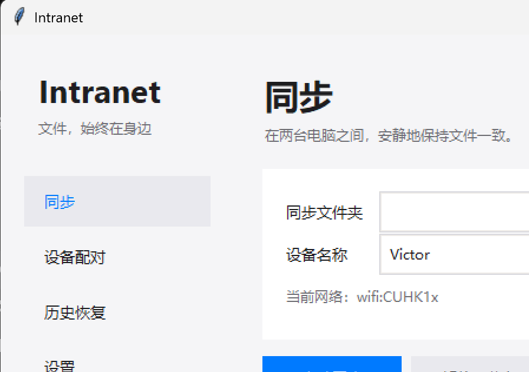
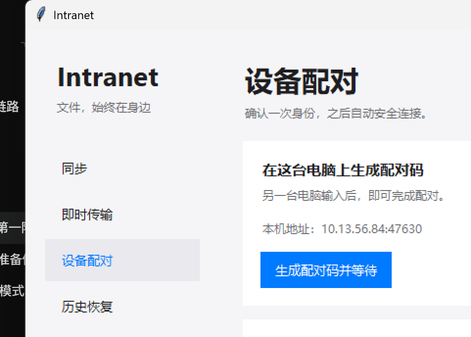
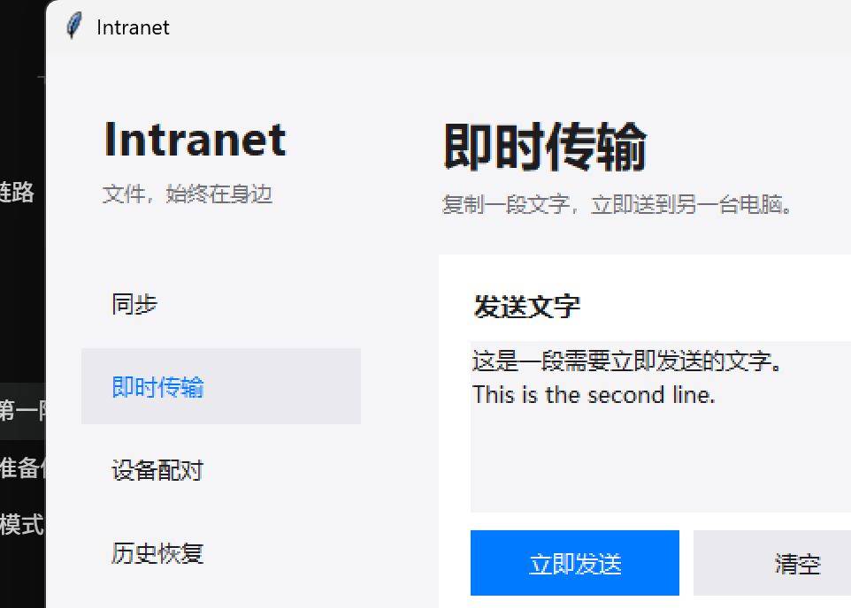

<h1 align="center">Intranet</h1>
<h3 align="center">文件，始终在身边</h3>
<p align="center">
  两台 Windows 电脑之间的安全局域网双向同步。<br>
  不用云盘，也不需要固定的主机或客户端。
</p>

<p align="center">
  
  
  
  
</p>

<p align="center">
  
</p>

## 为什么选择 Intranet

在台式电脑和手提电脑之间交替工作时，不应该反复复制文件，也不应该为了偶尔同步而配置一套复杂的云服务。Intranet 希望把体验做得像云盘一样自然，但文件只在你的两台电脑之间传输。

| 方式 | 优点 | 常见问题 |
|---|---|---|
| Windows 文件共享 | 系统自带 | 主从角色明显，配置和连接过程容易打断工作 |
| 云盘 | 跨网络、体验成熟 | 依赖第三方存储、网络和账户 |
| **Intranet** | 双向同步、本地完整文件、设备配对加密 | 目前面向两台固定 Windows 电脑，功能范围更专注 |

## 功能一览

| 能力 | 当前实现 |
|---|---|
| 双向同步 | 新增、修改、删除、重命名和移动，双方地位相同 |
| 文件完整性 | SHA-256 校验、原子替换、分块传输和断点续传 |
| 冲突处理 | 较新版本保留原路径，另一方生成冲突副本，不自动合并文档 |
| 历史恢复 | 被覆盖或删除的文件可以恢复，默认保留 30 天、最多 20 GB |
| 自动发现 | 支持子网定向广播；广播不可用时使用静态 `IP:端口` |
| 安全连接 | 一次性配对码、设备证书、双向 TLS 和受信任网络 |
| 即时文字 | 多行文字通过现有双向 TLS 即时收发，接收记录可复制且不写入普通日志 |
| 后台体验 | 自动同步、暂停与恢复、托盘通知、Windows 登录自启动 |
| 界面与安装 | 苹果简约风、主界面、历史恢复、当前用户安装与卸载 |

## 实测结果

以下数据来自两台真实电脑在同一手机热点下传输合成测试文件。它们用于证明技术方案的可行性，不代表所有网络都能达到相同速度。

| 指标 | Intranet TLS | Windows SMB |
|---|---:|---:|
| 第 1 轮 | 252.22 Mbps | 100.53 Mbps |
| 第 2 轮 | 177.31 Mbps | 39.93 Mbps |
| 第 3 轮 | 119.68 Mbps | 30.91 Mbps |
| **中位数** | **177.31 Mbps** | **39.93 Mbps** |

其他已验证指标：

- 定向广播发现：**0.828 秒**
- 小文件同步：**1.099 秒**
- Windows 整机重启后发现：**0.828 秒**
- 进程停止后续传：已有 **512,114,688 字节**，重启后仅传剩余 **24,756,224 字节**

完整证据见 [`docs/evidence/`](docs/evidence/)。

## 安装

### 使用安装包

当前安装包位于本机构建目录，尚未发布 GitHub Release：

```text
dist/installer/IntranetSetup.exe
```

安装只需当前用户权限，不需要管理员账户。安装器支持安装后启动和卸载。

### 从源码运行

需要 Windows 10/11 和 Python 3.10 或更高版本。

```powershell
git clone https://github.com/1Max1mus1/Intranet.git
cd Intranet
python -m pip install -r requirements.txt
python main.py
```

后台启动：

```powershell
python main.py --background
```

## 首次使用

1. **选择目录**：两台电脑分别选择要同步的本地文件夹，路径可以不同。
2. **完成配对**：一台在“设备配对”中生成配对码，另一台输入其 `IP:端口` 和配对码。
3. **信任网络**：回到“同步”，确认当前 Wi-Fi 并点击“信任此网络”。
4. **启动同步**：点击“启动同步”。关闭主窗口会隐藏到托盘，不会退出后台服务。

建议先用测试目录熟悉删除、冲突和历史恢复规则，再接入真实工作目录。程序默认不会自动选择或同步任何目录。

<p align="center">
  
</p>

## 即时文字传输

在“即时传输”页面粘贴文字并点击“立即发送”，即可通过已配对设备的双向 TLS 通道发送到另一台电脑。配对页会同时显示本机 `IP:端口`，并支持一键复制。

<p align="center">
  
</p>

## 数据与安全规则

- 删除会同步，删除记录用于防止离线旧文件重新出现。
- 被同步删除或覆盖的文件会进入历史区，可以在“历史恢复”中找回。
- 并发修改不会自动合并，双方内容都会保留。
- 排除路径只影响本机，不会因此删除另一台电脑上的对应文件。
- 未配对设备不能读取或写入同步目录。
- 未知网络默认暂停；只有明确信任的网络才允许自动同步。
- 配对码不写入普通配置或日志，设备私钥保存在当前用户的数据目录中。

## 构建安装包

构建依赖为 Python、PyInstaller 和 Inno Setup 6。

```powershell
python -m pip install -r requirements.txt
python -m pip install -r requirements-build.txt
powershell -NoProfile -ExecutionPolicy Bypass -File build.ps1
```

构建输出：

```text
dist/Intranet/Intranet.exe
dist/installer/IntranetSetup.exe
```

## 验证

```powershell
# 第一阶段：同步、冲突、续传、性能与安全验证
python -m validation.run_checks

# 第二阶段：真实本地 TLS 配对、双向同步、暂停恢复和 GUI
python -m validation.product_smoke --gui
```

安装器还经过静默安装、安装后启动、卸载和自启动注册表恢复验证。

## 项目状态

| 阶段 | 状态 |
|---|---|
| 同步引擎、TLS、冲突、历史、断点续传 | 已实现并有验证证据 |
| 主界面、托盘、自启动、安装包 | 已实现，苹果简约风 |
| 真实双机产品验收 | 待进行 |
| 真实工作目录 7 天试用 | 待进行 |
| 真实热点物理断网测试 | 按用户决定跳过，未验收 |
| Tailscale 按需文件传输助手 | 第三阶段，尚未实现 |

## 路线图

- **第二阶段验收**：真实双机安装、配对和同步，再进行至少 7 天真实工作目录试用。
- **第三阶段**：通过 Tailscale 提供按需“文件传输助手”，主动选择文件远程发送，不要求持续自动同步。
- **暂不安排**：多用户、多设备、多组同步空间、云端文件存储和在线占位符。

## 故障排查

- **发现不了设备**：确认双方处于同一受信任网络，并允许 Python 或 Intranet 通过专用网络防火墙。
- **广播不可用**：在“设置”中添加对方的 `IP:端口` 作为静态设备地址。
- **校园网或公共 Wi-Fi 不通**：网络可能限制设备互访，请换到可控私有网络，不要将其误判为同步引擎故障。
- **文件正在写入**：程序会稍后重试，不会把尚未稳定的文件标记为同步成功。
- **出现冲突**：检查原文件旁的冲突副本，手动决定最终版本。

## 文档

- [项目概览](PROJECT.md)
- [产品需求与验收标准](docs/prd.md)
- [技术验证计划](docs/validation.md)
- [架构概览](docs/architecture/overview.md)
- [路线图](docs/roadmap.md)
- [当前进度](docs/progress/current.md)
- [统一领域语言](CONTEXT.md)
- [第三阶段 Tailscale 决策](docs/adr/0001-tailscale-remote-transfer.md)

Intranet 是一个面向个人双机场景的项目。当前文档和验证证据用于说明真实实现范围，不把本机预验证等同于全部真实环境验收。
